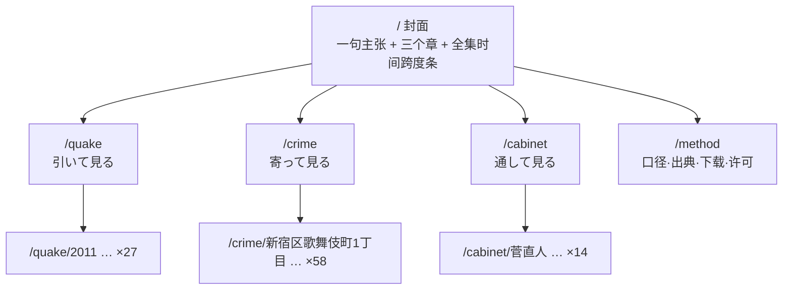
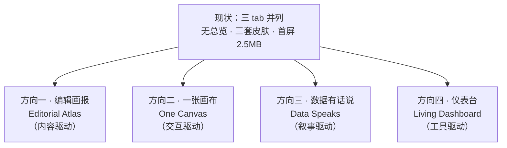

# Pan Out Japan · 获奖级升级诊断与方向

> 2026-10-19。本文件只回答三件事：**现在差在哪（有证据）**、**架构应该怎么合（§2，已定）**、**四个升级方向的评估记录（§3–5）**。
> 所有「实测」条目均来自本机带 GPU 的真实 Chromium 对 `https://japan.ouuut.com` 的取证，可复跑；外部参照均带 URL。
> 配套研究全文：`agent://AwardRefs`（获奖站拆解与评分标准）、`agent://JapanRefs`（日本本土产品）、`agent://TechPatterns`（架构与载荷）。

---

## 0. 一句话结论

**本站不是「设计不够好看」，是「产品概念没被实现」。**

站名 Pan Out = 拉远看全景，但界面上**没有任何一处是全景**：进站直接落进地震视图，三个数据集是三扇互不相通的门，靠顶部三个 tab 并列。获奖级数据站的第一性原理恰恰相反——先用一个连续坐标（时间 / 地理 / 索引图）建立全景，再让用户钻进去。缺了这一步，后面所有视觉打磨都只能得到「三个精致的小工具」，得不到「一个作品」。

**架构结论（§2 详述）**：三者**应当合在一起，但不能当成一个「应用」来合，要当成一本「刊物」来合**。它们不共享数据模型（地震是点、犯罪是面、支持率无地理），只共享主题；统一它们的是**尺度**——「Pan Out」是一个镜头手势的名字。所以：一仓一构建一部署、静态预渲染约 104 个状态页、每章各带自己的 renderer 按需加载，而不是一张画布 + 三个 tab。

---

## 1. 诊断：六层问题，逐条带证据

### 1.1 概念层：站名承诺的东西不存在

| 证据 | 实测 |
|---|---|
| 视图数量 | DOM 中只有 `v-quake` / `v-crime` / `v-cabinet` 三个 `<section class="view">`，**无总览页** |
| 进站落点 | `location.hash` 为空时 `route()` 强制 `h="quake"`，即直接进地震视图 |
| 概念文案 | 「Pan out＝引いて見渡す」只出现在 meta description 与 llms.txt，界面里零实现 |
| 唯一 h1 | 活动视图（quake）**没有 h1**；全站唯一 h1「内閣支持率 2000→」在隐藏的 cabinet 里 |

对照：SDG Atlas 用 3D 地球当目录（"This globe shows data from the story on SDG 8"）；mesh3d 首屏只有一句 "SCROLL TO DIVE IN" + 一个数字总览。**获奖站的首屏回答三件事：这是什么数据 / 多大量级 / 我现在能做什么。本站首屏只有「导航」。**

### 1.2 信息架构层：三个 tab 是最弱的一种组织方式

- 三个数据集**没有共享维度**（实测字段）：
  - 地震：`id, lon, lat, depthKm, mag, time, place` —— 无都道府县字段，地理只能靠经纬度反查
  - 犯罪：`n, w, lng, lat, t, bi, nb, r, v, o, r8, r8bi, ...` —— **仅东京都**，时间只有 R7/R8 两个年计
  - 支持率：`date, pm, value, source, url` —— 无地理维度
- 因此「跨数据集联动」不能硬做全连通。唯一站得住的共享维度是**时间**（且犯罪只能年粒度参与），其次是**地理**（但只覆盖地震×犯罪，且地震需先做县聚合）。
- 当前路由 `#/quake` 等 hash 形式，**三个视图 JS 中 0 处 `pushState`、0 处写 `location.hash`**：任何探索状态（选了哪年、哪个县、哪个内阁）都不可分享。

对照：Electricity Maps「observe the whole grid at once, or dive deep into any zone」——总览与局部是同一张地图的缩放；OWID 用查询参数承载状态（`?tab=map&time=2021&country=JPN~USA`）。Webby 原文：「allow you to form a mental model of the information provided」。

### 1.3 视觉系统层：三套皮肤拼在一个壳里

| 问题 | 实测证据 |
|---|---|
| **字体根本没加载** | 全站 `@font-face` 规则数 = **0**，`document.fonts` 为空，网络 0 个字体请求。声明了 Geist / Instrument Serif / JetBrains Mono / Noto Serif JP，**实际全部回退到 Arial / Georgia** |
| 三套 token 并存 | quake 用 vendor 自带变量 + 硬编码 hex；crime 用 `--bg-page/--text-main/--accent` 一套（35 处 `var(--…)`）；cabinet 用 `--muted/--ink` 另一套（8 处）。三套都定义在各自 view 内，无单一 tokens 文件 |
| 主题不一致 | 切到 sage（浅色）后：`body` 变 `rgb(233,237,227)`、crime 正常跟随，但 **quake viewport 仍是深底 `rgb(20,26,21)` + 深字 `rgb(23,33,26)`** → 黑块上写黑字；cabinet 走 `data-cab-variant="editorial"` 第三套 |
| 三套强调色 | quake 水印/CTA `#FF6A3D`、`#E8431A`；crime `#d0801a`；cabinet 琥珀色阶 `#d0801a→#6f675b`。同一个壳里三种「主色」 |
| 排版纪律缺失 | 正文字号 11–14px（DADS 规范：正文 ≥16px，<14px 原则上不允许）；行高 1.65；无字距分档；版心最宽 60ch（日经 VD 移动端 20 字/行、NHK 39 字/行） |

对照：日经 VD 用纯黑 + 单一 CTA 蓝 `#0075FF`；NHK 正文 `BIZ UDPGothic` 16px/28px（1.75）；デジタル庁 DADS 明文规定正文 ≥16px、行高 ≥1.5、字距按字号分 0/1%/2%。

### 1.4 数据叙事层：数字没有被翻译成人能感知的东西

- 地震：默认「历史」模式，数据**止于 2026-08-09**（`quakes.json` 最新 2026-07-15，manifest `coverageEnd: 2026-08-10`），今天 10-19，**已陈旧 70 天**；进站看到的是两个月前的点云。
- 犯罪：默认展示千人率分档，但**没有一句话告诉用户这个数字意味着什么**（中位 4.4‰；最高 豊島区西池袋1丁目 1331.5‰，而它 pop 只有 365——夜间住民数做分母，昼间人流做分子，见 2.7）。
- 支持率：14 条 series 用**同一琥珀色阶**区分（`#d0801a → #6f675b`），末任高市早苗线对比度仅 **3.47**，最难看清的恰是「最新那位」；y 轴固定 0–100 导致 **12.4% 绘图区永久空置**。
- **交接月处理（已核实，结论与直觉相反）**：`renderChart()` 以**首相就任日**切桶（`pmByDate`），同月两任**各自成一个点、不取平均**。所以 `2001-04` 的森 7.0 与小泉 80.0 是两条线上的两个点，不是 43.5。这一点做法是对的；真正的问题是**两个月都没有标注「就任前/后就任」**，读者会把它们当成同月可比的两次测量。

对照：Periscopic 不数死亡人数，数「STOLEN YEARS」；日经地震列岛把编码规则写进页面（球大小=M、暖色=M、寒色=深度、×=震央）。

### 1.5 性能与工程层：首屏 2.5MB，19 秒才出图

| 项 | 实测 |
|---|---|
| 地震首屏传输 | **≈2.5 MB br**（`japan-outline.json` 1.21MB + `quakes.json` 1.16MB + vendor 201KB） |
| 首屏等待 | 冷缓存下 `読み込み中 · Loading…` 持续 **10.5s 仍在**，约 19s 才撤 veil |
| 全站传输 | 20.8MB raw / **4.27MB br** |
| 缓存头 | 数据文件 `Cache-Control: public, max-age=0, must-revalidate` → 每次进视图都要重新验证 |
| 404 语义 | 任意不存在路径返回 **200 + index.html**（`/nonexistent-xyz` → 200 text/html）→ 数据加载失败会静默变成 HTML 解析错误 |
| 旧路径陷阱 | `/crime/`、`/cabinet/` 返回 200 HTML，但模块按相对路径解析 → `[shell] view load failed` → **卡在 quake 占位符，并外泄「three.js canvas mounts here」**。而 crime 视图自己的页脚就链到 `../quake/`、`../cabinet/` |
| 占位文案 | 生产 DOM 中仍有 `プレースホルダ` ×6、`three.js canvas mounts here` |
| 水印残留 | vendor 在 canvas 上绘制 `quake.japan.ouuut.com`（2 处） |

对照：earth.nullschool 移动端另出 110m + tiny 海岸线；PMTiles/FlatGeobuf 按视口取；首屏预算 ≤300KB 是业界常规。

### 1.6 可访问性与细节层：目前对键盘/读屏用户不可用

| 项 | 实测 |
|---|---|
| ARIA | `quake/view.js` aria-* **0 次**、`cabinet/view.js` **0 次**、`tabindex` 全站 **0 次**；crime 有 11 处 |
| 跳转链接 | 无 skip link |
| 主题按钮 | 只有 `title="sage"` / `title="dark"`，**无可访问名称** |
| reduced-motion | 全站仅 1 条 `prefers-reduced-motion` 规则；而 3D 地球 idle 自转属于 WCAG 2.2.2「自动开始且持续 >5 秒的移动内容」，**必须有暂停控件** |
| 移动端溢出 | 390px 视口下 `documentElement.scrollWidth` = 481，**横向溢出 91–106px**；元凶 `.tools`(right 469) + `.theme-dots`(right 481) |
| 布局碰撞 | cabinet：HUD 压绘图区 **469×147px**；X 轴标签带 788–888px 被 controls(781–872) 覆盖 **84px**（这就是截图里看不到年份刻度的原因）。crime：全站页脚压 Leaflet 版权条 **145×18px** |
| 坐标轴 bug | 3 个月视图 X 轴渲出 `02:26:52 800` / `8` / `15` / `22` / `29`——时间轴标签格式化漏出时间分量 |
| 语言不同步 | 切 EN 后 shell 变英文，**crime 面板标签仍日文** |

### 1.7 对照 Awwwards 判据的量化差距

权重：Design 40 / Usability 30 / Creativity 20 / Content 10；HM 门槛 6.5，SOTD 更高。

| 维度 | 现状判断 | 依据 |
|---|---|---|
| Design（40%） | **弱** | 声明字体未加载（回退 Arial/Georgia）；三套 token/三套强调色；正文 11–14px；三视图视觉语言互不相干 |
| Usability（30%） | **弱** | 无总览、状态不可分享、移动端横向溢出、X 轴被遮、旧路径 404 陷阱、加载 19s |
| Creativity（20%） | **弱** | 「Pan Out」概念零实现；无签名时刻；动效仅有 vendor 自带自转 |
| Content（10%） | **弱** | 数据体量扎实（40,079 震源 / 5,234 町丁 / 642 点），但**支持率序列有 8 个月系统性错位**（见 2.7）、10 组重复冲突行、69/338 月单源；无口径说明、无下载、无方法学 |

**结论：这不是「再打磨一轮」能到 6.5 的状态，是需要重做信息架构与视觉系统。**

---

## 2. 架构决定（最终）

**合，但当前这个「合」法是错的。错不在把三份内容放在一起，错在把它们当成一个「应用」来合。应当当成一本「刊物」来合。**

### 2.1 为什么三者不能共享交互

实测 schema：

| 数据集 | 元组 | 时间粒度 | 地理覆盖 |
|---|---|---|---|
| 地震 | `(lon, lat, depth, mag, timestamp)` | 日/秒，40,079 条 | 全国 + 海域 20–50°N / 120–150°E |
| 犯罪 | `(polygon, count, population, year)` | **仅 2 个年度快照**（R7 年计 / R8 累计） | **仅东京 62 区市町村（其中 58 个有町丁级数据）**，5,234 町丁 |
| 支持率 | `(date, value, pollster)` | 月，642 条 | **无地理维度** |

判据：**共享数据模型或共享交互 → 合并；只共享主题 → 分开。** 三者只共享主题。

「一张画布」为什么是陷阱，具体到操作：把时间轴拖到 2011-03，地震层亮起（当年 5,852 次），支持率层给出 18.9%，**犯罪层什么都不会发生**——它只有 R7/R8 两个快照。三个图层里有一个不动，联动就是假的。

### 2.2 为什么也不能拆成三个站

现在三个 view 是运行时 ESM 模块各自加载（`[shell] view load failed` 即由此产生），这已经是「最坏的两头」：付了 shell 的复杂度，又没拿到共享设计系统。拆成三个独立站只会把这个状态固化。

### 2.3 真正统一它们的是「尺度」，不是「数据」

「Pan Out」是**镜头手势**的名字，不是某一个视图的名字。三个数据集恰好落在三个数量级的地理粒度上：

- 引いて見る：列島 × 26 年 × 40,079 次
- 寄って見る：一町丁 × 1 年 × 5,234 区画
- 通して見る：一つの数字 × 28 年 × 642 回

这不是硬凑——**「一张画布」恰恰与站名自相矛盾**：把所有东西压进同一张地图，就没有「拉远」这回事了。

### 2.4 最终 IA

预渲染约 **104 个状态页**（1 封面 + 3 章 + 27 年 + 58 个有町丁数据的区市 + 14 内阁 + method），每个都是真实 HTML，带正确 title/OG/description，hydrate 后进入完整交互。一举解决：404 语义、可分享、SEO、首屏、社交预览卡。

### 2.5 技术架构

一仓 · 一构建 · 一部署（Astro 或 Vite MPA，静态预渲染）：

- **共享**：`tokens.css`（唯一一套）、字体子集（BIZ UDPGothic 正文 + Noto Serif JP 标题 + JetBrains Mono 数字）、chrome、路由、分析
- **各自懒加载**：renderer（three.js 只在 quake 路由加载）、数据（quake 按年分片、crime 按区、cabinet 单文件）
- **路由**：History API + 每路由静态 HTML；不存在路径返回**真 404**
- **状态**：进 URL（`/quake/2011?m=5&depth=30`），可复制、可回退

### 2.6 载荷预算（按实测数据重算）

| 路由 | 现在 | 目标 | 手段 |
|---|---|---|---|
| 封面 | — | ≤50 KB | 纯静态 |
| /quake | 2.5 MB | ≤300 KB | 点列二进制 11 B/条（int16 lon/lat、uint16 depth、uint8 mag、uint32 time）→ 441 KB raw / ~180 KB br；轮廓降 0.05°/3dp |
| /crime | 1.64 MB | ≤400 KB | TopoJSON + 简化；首屏只出区级，町丁按需 |
| /cabinet | 168 KB | ≤60 KB | 压缩即可 |
| /method | — | ≤30 KB | 纯静态 |

### 2.7 数据审计（本轮用一手源逐列核对，发现硬错误）

**支持率序列存在系统性错位，必须修。** 用 NHK 放送文化研究所 2000–2012 年度表逐列核对（13 年 × 12 月，含 緊急 列）：

| 年月 | NHK 原表 | 站点现值 | 说明 |
|---|---|---|---|
| 2008-09 | 20（福田） | 48 | 站点取了「9月(緊)」的 48（麻生紧急调查） |
| 2008-10 | 46（麻生） | 48 | 整体前移一个月 |
| 2008-11 | 49（麻生） | 46 | 同上 |
| 2008-12 | 25（麻生） | 49 | 同上 |
| 2009-09 | **15（麻生）** | **72** | 站点取了「9月(緊)」的 72（鸠山紧急调查） |
| 2009-10 | 70（鳩山） | 72 | 整体前移一个月 |
| 2009-11 | 65（鳩山） | 70 | 同上 |
| 2009-12 | 56（鳩山） | 65 | 同上 |

成因：NHK 年度表在新内阁成立月有「通常月」与「緊急調査」两列，抓取时按序号对齐，把第二列当成了下一个月。**后果是 2009-09 被记成麻生 72%（实际 15%），从而伪造出「+49.0 最大月涨」这一全站最戏剧化的峰值。**

修正后：

| 指标 | 修前 | 修后 |
|---|---|---|
| 最大月涨（同内阁内） | +49.0（2009-08→09 麻生） | **+20.5（2010-08→09 菅）** |
| 最大月跌（同内阁内） | −25.5（2010-06→07 菅） | −25.5（不变） |
| 麻生内阁均值 | 33.7 | **28.2** |
| 鳩山内阁均值 | 50.4 | **49.4** |

另有两类缺陷：

- **10 组 `(date, pm, source)` 重复且值冲突**（全部来自日経），如 `2008-08-01 福田 [38, 29]`、`2016-08-01 安倍 [58, 62]`。去重后 10 个月的均值变化，最大 ±2.3。
- **单源问题**：338 个「内阁-月」桶里有 **69 个只有 1 家来源**（自然月口径：56 / 331 个月单源），而页面文案写「多社平均」。含 2011-03（仅时事 18.9；NHK 原表该月为 `-`，震灾停调）。这类月份必须标 `n=1`。

**犯罪数据的语义与站点显示不一致：**

- `r` 字段是**粗暴犯件数**，不是「率」。`bi + nb + r + v + o = t` 对 5,234 行全部成立。
- `g`（A–E 等级）在 `view.js` 中**从未被读取**，是死数据；`meta.json` 声称做了「小人口收缩 K=2000」，但渲染代码里没有收缩。
- 站点实际显示的是裸 `t/pop*1000`，门槛 `pop >= 200`。结果：中位 4.4‰，p90 13.3‰，**max 1331.5‰（豊島区西池袋1丁目，pop=365）**。头部全是昼间人口造成的分母伪影——西池袋1丁目白天有车站与商业，夜间住民只有 365 人。而真正最该被看到的歌舞伎町1丁目（t=962 / pop=143）被 `pop<200` 门槛直接挡掉，在地图上显示为「无人口」。

**地震数据：**

- 仅收录 M≥4（min = 4.0，共 40,079 条）。页面若写「40,079 次地震」必须注明「M4 以上」。
- 2011 年占全部条数 **14.6%**，但占释放能量 **86.7%**（E ∝ 10^1.5M）。2011-03-11 单日 539 条 = 全网 85.95%。**这个对比本身就是最好的开场叙事，而且现在的界面完全没有表达它。**

---

## 3. 四个升级方向（评估记录，非最终方案）

四个方向不是「同一条路的不同档位」，而是**四种不同的产品主张**。可以单选，也可以按 A→D 顺序叠加。

### 方向一 · 编辑画报（Editorial Atlas）

**主张**：把它做成一本「日本数据画报」，不是工具集合。视觉主导，内容为骨。

- **签名时刻**：首屏是一张全屏的日本列岛，上面同时叠着三种语义层（震源密度 / 犯罪率分档 / 支持率曲线以「时间轴条带」形式横贯底部），**一屏看见三个数据集的存在**，点击任一层才进入该主题。
- **关键做法**：
  - 统一字体系统：自托管 `BIZ UDPGothic`（正文，≥16px，行高 1.75）+ `Noto Serif JP`（标题）+ `JetBrains Mono`（数据），真正落 `@font-face` 并子集化
  - 单一 tokens 文件，三视图全部消费同一套；暗色为主、纸白为可选 variant（不是现在这种「半套跟随」）
  - 竖排只用于区块标签（`writing-mode: vertical-rl`，30px 级，ls 10px）——照抄岩波/無印的参数，作为「日本性」的唯一装置，不做全站竖排
  - 每个视图固定六件套：更新时间戳（到分）、图表下出典行、口径整段、基准日、版权逐项、CSV 下载
- **参考**：日经ビジュアルデータ（Good Design 2017 金賞）、朝日データジャーナリズム、岩波書店竖排参数
- **工作量**：中高（视觉重做 + 字体管线 + 三视图皮肤统一），约 3–4 个工作日
- **风险**：视觉投入大但不改架构，**可能仍然「好看但不可玩」**；如果只做这一项，Awwwards Creativity 分依然偏低

### 方向二 · 一张画布（One Canvas）

**主张**：取消三个 tab，做一张「日本列岛 × 时间」的双轴画布，三套数据是同一画布上的三种图层。

- **签名时刻**：进站是一张可拖动的日本列岛 + 底部一条 1970→2026 的时间轴。拖动时间轴，震源点亮起（按年累积）；把图层切到「犯罪」，同一张地图上东京都的町丁分档亮起；切到「支持率」，列岛淡出、曲线从时间轴位置生长出来。**同一套手势，三种数据。**
- **关键做法**：
  - 统一地理底座：一份都道府县 GeoJSON（地震按县聚合、犯罪按市区町村、支持率无地理→显示为「全国」单值，明示「此数据集无地理维度」比假装联动专业）
  - 共享时间轴组件：地震日粒度、犯罪年粒度、支持率月粒度，**各自标注粒度**，不做伪同步
  - 状态全部进 URL：`/quake/2024-01-01..2024-12-31?m=4.5&pref=13`
  - 路由从 hash 改 History API + 每路由预渲染静态 HTML
- **参考**：Electricity Maps（总览↔局部同一张地图）、SDG Atlas（地球当目录）、earth.nullschool（状态进 hash）、Felt（表格⇄地图双向选中）
- **工作量**：高（重构路由 + 统一地理底座 + 跨视图状态管理），约 5–7 个工作日
- **风险**：**地理联动只覆盖两个数据集**，支持率无法参与地理维度；若强行做会变成「为了联动而联动」。另外 3D 地球与 2D 地图合并到一张画布，技术上要选一个渲染栈（建议 Leaflet/MapLibre 2D 为主，3D 地球作为「全球视角」的独立模式）

### 方向三 · 数据有话说（Data Speaks）

**主张**：每个数据集先讲一个 3–5 屏的滚动故事，讲完再放开自由探索（martini glass 结构）。

- **签名时刻**：地震视图开场不是地球，而是一句话 + 一个对比：「2011 年只占全部地震次数的 14.6%，却占了 86.7% 的能量。」然后滚动，点云按能量而非次数重绘。犯罪视图开场：「东京每 1,000 人 7 起。但把地图放大到町丁，最高一格是 1,331‰——那里白天有 10 万人经过，夜里只有 365 人住。」支持率开场：「高市内阁上任首月 71.0%，此后 12 个月连续回落至 52.1%。」
- **关键做法**：
  - `position: sticky` 图形 + 正常文档流步骤文字；Scrollama（2KB）做步骤触发，**不用 ScrollTrigger**（避免与 WebGL 争主线程）
  - 禁用 `vh` 做尺寸（移动端工具栏会跳动）；移动端降级为堆叠
  - 每步必须带来**语义可见的变化**，且向上滚能完整还原
  - 必须给进度指示 + 可点击跳步（Kosara 对 scrollytelling 的核心批评）
- **参考**：The Pudding「This is a teenager」（IIB 2024 Gold）、Zoonotic Web（sticky 网络图）、Mapbox Storytelling
- **工作量**：中（叙事脚本 + 每视图 3–5 屏），约 3–4 个工作日
- **风险**：**叙事需要真正的观点**，写不好就是「三个不相关的故事拼盘」——正是现在的问题。且只能讲一条线，复用性差

### 方向四 · 仪表台（Living Dashboard）

**主张**：承认它是工具，把它做成最好用的那一个。实时优先、数据新鲜度第一。

- **签名时刻**：进站第一眼是「此刻的日本」——最新地震（实时 USGS 拉取）、本月支持率、本年犯罪数据，三个数字带时间戳并排，点进去才是细节。
- **关键做法**：
  - 默认「实时」模式（现在默认是历史模式且数据陈旧 70 天）
  - 建数据新鲜度看板：每个数据集标注「最后更新 / 下次预期更新 / 数据源」，过期即显式告警
  - 加载策略：首屏只取最近 12 个月（列存二进制 16B/条，4 万点 → 300KB br）；几何降到 0.05°/3 位小数（1.21MB → 301KB br）；全量按年分片
  - 四级降级：海报帧 → 2D SVG → 低 DPR WebGL → 全量 WebGL
  - 每个可视化配平行 DOM：数据表 + 一句话摘要 + CSV
- **参考**：Yahoo!天気（时刻戳置顶）、気象庁キキクル（出典常驻 + 时间轴）、警視庁犯罪マップ（基准日 + 三种时间口径）、e-Stat（字号切换）
- **工作量**：中（主要是数据管线与加载策略），约 3–4 个工作日
- **风险**：**最不「惊艳」**。工具做到极致是 7 分不是 9 分；但如果目标是「有人真的每天用」，这条最实

---

## 4. 四个方向对比

| | 方向一 编辑画报 | 方向二 一张画布 | 方向三 数据有话说 | 方向四 仪表台 |
|---|---|---|---|---|
| 产品主张 | 数据画报 | 统一探索器 | 叙事作品 | 实用工具 |
| 签名时刻 | 三种语义层叠一屏 | 一条时间轴驱动三种数据 | 一个数字炸开成 26 年 | 此刻的日本 |
| Awwwards Design 40% | 强 | 中 | 中 | 弱 |
| Usability 30% | 中 | 强 | 中 | 强 |
| Creativity 20% | 中 | 强 | 强 | 弱 |
| Content 10% | 强 | 中 | 强 | 强 |
| 工作量 | 3–4 天 | 5–7 天 | 3–4 天 | 3–4 天 |
| 最大风险 | 好看但不可玩 | **已否决**：犯罪仅 2 个快照，联动必有一层不动 | 需要真观点 | 不惊艳 |
| 适合的下一步 | 提供视觉系统 | 不采用 | 提供章节开场 | 只取「新鲜度」一条 |

---

## 5. 推荐顺序

**先修地基（不修则任何方向都白做），再选方向。**

### P0 · 地基（1–2 天，与方向无关，必做）

1. **字体真正落地**：自托管 `BIZ UDPGothic`（正文）+ `Noto Serif JP`（标题）+ `JetBrains Mono`（数据），子集化，`font-display: swap`。当前 `@font-face` = 0，所有排版声明都是空的。
2. **单一 tokens 文件**：三视图统一消费；删掉各自硬编码 hex。
3. **修真实缺陷**：
   - `/crime/`、`/cabinet/` 旧路径 → 301 到 `#/crime` 或返回真 404（现在卡死并外泄占位文案）
   - 缺失资源返回真 404，不回退 index.html
   - 数据文件缓存头改 `immutable` + 内容哈希
   - 删除生产 DOM 里的 `プレースホルダ` ×6 与 `three.js canvas mounts here`
   - 移除 vendor 的 `quake.japan.ouuut.com` 水印
4. **移动端横向溢出**：`.tools` / `.theme-dots` 在 390px 下溢出 91–106px。
5. **布局碰撞**：cabinet X 轴被 controls 盖 84px、HUD 压绘图区 469×147px；crime 页脚压版权条 145×18px。
6. **可访问性底线**：skip link、主题按钮可访问名称、`prefers-reduced-motion` 覆盖三视图、地球自转加暂停键。
7. **数据新鲜度**：地震数据陈旧 70 天，默认模式改为「实时」或在首屏显式标注「数据截至 2026-08-09」。

### P1 · 架构迁移（§2 已定，不再「选方向」）

§3 的四个方向只是评估记录。**方向二（一张画布）已在 §2.1 被否决**——它和站名「Pan Out」自相矛盾，且犯罪只有两个年度快照，时间轴联动必然有一层不动。剩下三个方向不是互斥选项，而是同一本刊物的三件东西：

1. **§2.5 的结构**（一仓一构建、静态预渲染 104 页、真 404、URL 带状态）——这是地基，先做。
2. **方向一**提供视觉系统（一套 tokens、一套字体、封面/章节/详情的三级版式）。
3. **方向三**提供每章的 3 屏开场（用 2.7 里那些已验证的数字）。
4. **方向四**只在「数据新鲜度」这一条上被采纳（首屏标注截至日、实时模式），不采纳「仪表台」整体形态。

顺序：P0 → §2.5 结构 → 方向一 → 方向三 → 方向四的新鲜度部分。理由：结构决定其余三件的落点；视觉决定第一印象（Design 40%）；开场决定记忆点（Creativity 20%）；新鲜度是可信度补丁，随时可加。

### P2 · 数据修正（独立于设计，但决定可信度）

1. **修 2008-09～12、2009-09～12 共 8 个月的 NHK 错位**（见 2.7）：NHK 年度表在政权交接月有「通常月」与「緊急調査」两列，抓取按序号对齐导致整体前移一个月。修正后 2009-09 麻生由 72 改为 15，全站「+49.0 最大月涨」消失，真实最大月涨为 +20.5。
2. **删 10 组重复且冲突的行**（全部是日経，同一 `date/pm/source` 两个值）。保留哪一条需要回日経原页确认，不能随手取一。
3. **标注单源月份**：69/338 个月只有 1 家来源，页面写「多社平均」不成立；tooltip 必须显示 `n`。
4. **犯罪率口径二选一**：要么真的实现 `meta.json` 承诺的「小人口收缩 K=2000」，要么改文案说明「裸千人率、小分母町丁偏高」；并给 122 个无人口町丁与 163 个 `pop<200` 町丁分别一个可见的「人口不详 / 分母过小」样式，而不是静默按无数据处理。
5. **`g`（A–E 等级）要么渲染要么删**：现在是 5,234 行里的死字段。
6. **交接月标注**：同月两任的点都保留（做法正确），但加「就任前/后就任」标签，避免被读成同月两次可比测量。
7. 每个数据集补口径说明（样本设计、调查方法、已知伪影、暂定值）与 CSV 下载。

---

## 6. 首屏改造对照（具体到元素）

| 现在 | 改成 |
|---|---|
| 顶部三个 tab | 首屏一句对象 + 一个量级数字 + 一个动词；tab 降为视图内二级导航 |
| 进站落 quake，19s Loading | 首屏 ≤300KB br，海报帧先出，数据后到 |
| 无 h1 | 每视图唯一 h1，且是「结论句」而非「模块名」 |
| 三套强调色 | 单一强调色（建议沿用 ouuut 的 `#FF6A3D`），覆盖率 ≤3% |
| 11–14px 正文 | ≥16px，行高 1.6–1.75，字距按字号 0/1%/2% 分档 |
| 无出典/无更新时刻 | 六件套固定位（见 1.4 对照） |
| 无数据下载 | 每个视图 CSV 下载 + 引用格式 |

---

## 7. 附：可直接引用的关键数字

**地震**：40,079 点（2000-01→2026-07）；M7+ 40 次；M6+ 421 次；M5+ 4,516 次；最深 686km；<30km 浅源 16,065 次；2011 年 5,852 次（最忙年）；最大 M9.1（2011-03-11）

**犯罪**：5,234 町丁（58 市区町村，R7 年计 + R8 累计）；全东京合计 7.0‰；町丁中位 4.4‰、p90 13.3‰、p99 83.3‰、最高 1331.5‰（豊島区西池袋1丁目，pop=365）；pop<200 的 285 个町丁（占 5.4%）承载 7.6% 的案件；另有 122 个町丁无人口数据

**支持率（修正后）**：642 点 → 去重 632 → 331 个自然月 / 338 个内阁-月桶；14 内阁；最大月跌 −25.5（2010-06→07 菅）；最大月涨 **+20.5**（2010-08→09 菅，**不是**修前的 +49.0）；内阁均值最低 森喜朗 21.3、最高 高市早苗 62.5；高市 13 个内阁-月 71.0（2025-10）→ 52.1（2026-10）

**地震（能量口径）**：2011 年 = 全期条数的 **14.6%**，但 = 释放能量的 **86.7%**；2011-03-11 单日 539 条 = 全网 85.95%

---

## 8. 研究来源索引

- **获奖站拆解与评分标准**：`agent://AwardRefs` —— 12 个案例、7 条共性机制、Awwwards/Webby/IIB/FWA 官方标准原文
- **日本本土产品**：`agent://JapanRefs` —— 12 个案例、17 条可信感做法、13 条日本性手法、5 个设计奖案例、实测排版参数
- **架构与载荷**：`agent://TechPatterns` —— 8 个产品的 IA 解剖、三种骨架、scrollytelling 实现、载荷五杠杆、四级降级、性能预算表
